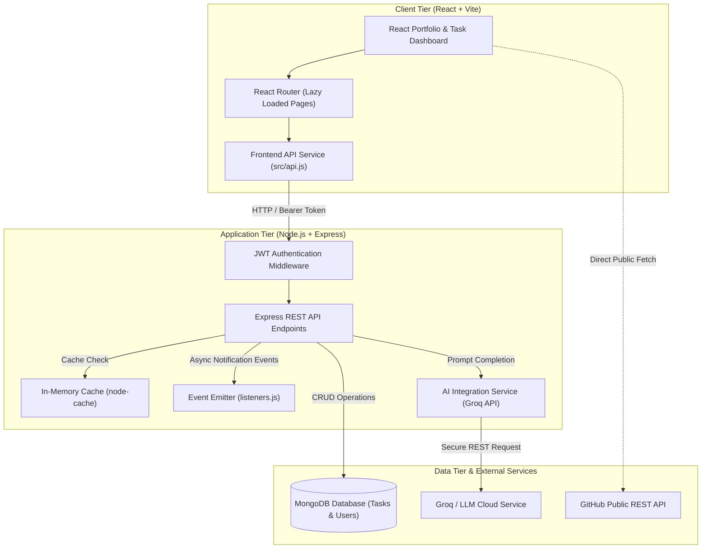

# Task Manager & Student Portfolio — Practicals 1 to 13

### Advanced Web Development Frameworks (AWDF / ITUE301)

| Parameter | Details |
| :--- | :--- |
| **Course Title** | Advanced Web Development Frameworks (AWDF) |
| **Course Code** | ITUE301 |
| **Student Name** | Sahil Makwana (or customize with your name) |
| **Student ID** | `24IT045` (or customize with your ID) |
| **Institution** | Faculty of Technology and Engineering |
| **Academic Year** | 2026 |

---

## Executive Summary

This repository presents an end-to-end full-stack web engineering project developed progressively across **13 laboratory practicals** for the Advanced Web Development Frameworks curriculum. The project combines a modern student developer portfolio with an enterprise-ready Task Management application featuring:

- **Frontend:** React, Vite, React Router, Lazy Loading/Code Splitting, Glassmorphism UI
- **Backend:** Node.js, Express.js RESTful API, Custom Middlewares, Event Bus
- **Database:** MongoDB & Mongoose Object Data Modeling (ODM)
- **Security:** JSON Web Tokens (JWT), bcrypt password hashing, input sanitization
- **Performance:** In-Memory Caching with `node-cache`, asynchronous event loops
- **DevOps:** Containerization with Docker & Docker Compose, CI/CD automation via GitHub Actions
- **AI Integration:** Generative AI task description synthesis via Groq/OpenAI API with robust offline fallbacks

---

## Architecture Diagram



---

## Laboratory Practicals (1 to 13) Index & Implementation

| Practical | Academic Topic | Key Files & Implementation Details |
| :---: | :--- | :--- |
| **1** | **Introduction to React & Component Architecture** | Created reusable UI components ([`Header.jsx`](file:///student-portfolio/src/components/Header.jsx), [`About.jsx`](file:///student-portfolio/src/components/About.jsx), [`Skills.jsx`](file:///student-portfolio/src/components/Skills.jsx), [`Footer.jsx`](file:///student-portfolio/src/components/Footer.jsx)) utilizing functional components, props passing, and modular CSS. |
| **2** | **State Management & Client-Side Routing** | Configured `react-router-dom` with navigation links, dynamic view switching, controlled form state in [`Contact.jsx`](file:///student-portfolio/src/pages/Contact.jsx), and reactive feedback states. |
| **3** | **External REST API Integration & Data Rendering** | Implemented asynchronous data fetching in [`Projects.jsx`](file:///student-portfolio/src/pages/Projects.jsx) consuming GitHub's public REST API, incorporating search filtering, loading spinners, and graceful error states. |
| **4** | **RESTful API Development with Node.js & Express** | Built a modular Express backend in [`server.js`](file:///task-manager-api/server.js) with standard HTTP verbs (GET, POST, PUT, DELETE), request logging middleware, and global error handlers. |
| **5** | **MongoDB Schema Modeling with Mongoose** | Defined persistent schemas in [`models/Task.js`](file:///task-manager-api/models/Task.js) and [`models/User.js`](file:///task-manager-api/models/User.js) with validation rules, enum restrictions, trimming, and lifecycle hooks. |
| **6** | **Full-Stack Integration (React to Express to Mongo)** | Connected frontend [`api.js`](file:///student-portfolio/src/api.js) and [`TaskManager.jsx`](file:///student-portfolio/src/pages/TaskManager.jsx) to backend endpoints for persistent task CRUD operations. |
| **7** | **Authentication & Middleware Pipeline** | Added user registration, bcrypt password hashing, stateless JWT issuance/verification, and route protection middleware (`authenticateToken`). |
| **8** | **Performance Optimization & Code Splitting** | Integrated `React.lazy()` and `<Suspense>` in [`App.jsx`](file:///student-portfolio/src/App.jsx) to split route-level bundles and decrease initial page load time. |
| **9** | **In-Memory Caching & Query Optimization** | Integrated `node-cache` in [`cache.js`](file:///task-manager-api/cache.js) to serve `GET /tasks` directly from memory on cache hit and automatically invalidate the cache upon write operations. |
| **10** | **Asynchronous Event-Driven Architecture** | Implemented Node.js `EventEmitter` in [`events.js`](file:///task-manager-api/events.js) and [`listeners.js`](file:///task-manager-api/listeners.js) to decouple task lifecycle logging and simulated notification dispatch from the main request thread. |
| **11** | **Containerization with Docker & Docker Compose** | Authored multi-stage [Dockerfile](file:///student-portfolio/Dockerfile) for frontend, Node [Dockerfile](file:///task-manager-api/Dockerfile) for backend, and [docker-compose.yml](file:///docker-compose.yml) linking MongoDB, backend, and frontend. |
| **12** | **CI/CD Pipeline with GitHub Actions & Automated Testing** | Created [`.github/workflows/ci.yml`](file:///.github/workflows/ci.yml) and automated unit/API test suites using Jest and Supertest in [`server.test.js`](file:///task-manager-api/server.test.js). |
| **13** | **Generative AI API Integration & Responsible Fallbacks** | Developed authenticated `/api/ai/generate-description` endpoint calling Groq LLM API with structured fallback templates, editable description preview, and loading indicators in the UI. |

---

## REST API Reference

All protected endpoints require an `Authorization: Bearer <token>` HTTP header.

| Method | Endpoint | Auth | Purpose |
| :--- | :--- | :---: | :--- |
| `GET` | `/` | No | Service health check and status |
| `POST` | `/register` | No | Register new user account with hashed password |
| `POST` | `/login` | No | Authenticate user credentials and receive JWT |
| `GET` | `/me` | **Yes** | Fetch current logged-in user profile |
| `GET` | `/tasks` | **Yes** | Retrieve all tasks (served via cache if available) |
| `GET` | `/tasks/:id` | **Yes** | Retrieve single task record by MongoDB ObjectId |
| `POST` | `/tasks` | **Yes** | Create new task (invalidates cache, triggers event) |
| `PUT` | `/tasks/:id` | **Yes** | Update task (invalidates cache, triggers event) |
| `DELETE` | `/tasks/:id` | **Yes** | Delete task (invalidates cache, triggers event) |
| `POST` | `/api/ai/generate-description` | **Yes** | Synthesize actionable task description via AI |

---

## Directory Structure

```text
awdf-task-manager-portfolio/
├── .github/
│   └── workflows/
│       └── ci.yml                 # Practical 12: GitHub Actions Automated CI
├── student-portfolio/             # Practicals 1, 2, 3, 6, 7, 8, 13 (Frontend)
│   ├── public/                    # Static assets & icons
│   ├── src/
│   │   ├── components/            # Practical 1: Modular Components
│   │   │   ├── Header.jsx
│   │   │   ├── About.jsx
│   │   │   ├── Skills.jsx
│   │   │   └── Footer.jsx
│   │   ├── pages/                 # Practical 2: Routed Pages
│   │   │   ├── Contact.jsx        # Practical 2: Controlled Form
│   │   │   ├── Projects.jsx       # Practical 3: External GitHub REST API
│   │   │   ├── Login.jsx          # Practical 7: Authentication UI
│   │   │   └── TaskManager.jsx    # Practicals 6, 9, 10, 13: Full Dashboard
│   │   ├── api.js                 # Centralized API Service
│   │   ├── App.jsx                # Practical 8: React.lazy & Suspense Routing
│   │   ├── App.css                # Polished Modern Dark Theme Styles
│   │   └── main.jsx
│   ├── Dockerfile                 # Practical 11: Frontend Containerfile
│   └── package.json
├── task-manager-api/              # Practicals 4, 5, 6, 7, 9, 10, 12, 13 (Backend)
│   ├── models/                    # Practical 5: Mongoose Schemas
│   │   ├── Task.js
│   │   └── User.js
│   ├── cache.js                   # Practical 9: In-Memory Caching (node-cache)
│   ├── events.js                  # Practical 10: Event Bus (EventEmitter)
│   ├── listeners.js               # Practical 10: Event Listeners & Logger
│   ├── server.js                  # Practicals 4, 6, 7, 13: Core Express API
│   ├── server.test.js             # Practical 12: Jest & Supertest Tests
│   ├── Dockerfile                 # Practical 11: Backend Containerfile
│   ├── package.json
│   ├── .env.example
│   └── .env                       # Local secrets (excluded from Git)
├── docker-compose.yml             # Practical 11: Multi-Container Orchestration
├── .gitignore
└── README.md
```

---

## Setup & Running Guide

### Option 1: Running with Docker Compose (Recommended)

Make sure Docker Desktop is running on your machine:

1. Clone or navigate to the repository directory:
   ```bash
   cd awdf-task-manager-portfolio
   ```

2. Configure backend environment file (`task-manager-api/.env`):
   ```env
   PORT=5000
   MONGODB_URI=mongodb://mongodb:27017/taskdb
   JWT_SECRET=awdf_super_secret_jwt_key_2026_secure
   GROQ_API_KEY=your_optional_groq_api_key_here
   ```

3. Build and launch all container services:
   ```bash
   docker compose up --build -d
   ```

4. Access the applications:
   - **Frontend Portfolio & Task Dashboard:** [http://localhost:5173](http://localhost:5173)
   - **Backend REST API:** [http://localhost:5000](http://localhost:5000)

5. Inspect logs or shut down:
   ```bash
   # Follow backend logs
   docker compose logs -f backend

   # Stop all services
   docker compose down
   ```

---

### Option 2: Running Locally without Docker

#### Prerequisites
- Node.js (v18 or higher)
- MongoDB instance (local service on `mongodb://localhost:27017` or MongoDB Atlas URI)

#### 1. Backend Setup
```bash
cd task-manager-api
npm install
node server.js
```
The API starts on `http://localhost:5000`.

#### 2. Frontend Setup
In a new terminal window:
```bash
cd student-portfolio
npm install
npm run dev
```
Open [http://localhost:5173](http://localhost:5173) in your browser.

---

## Automated Testing & CI/CD (Practical 12)

The project includes unit and integration tests covering:
- Health check endpoints
- JWT authentication and token rejection
- Model validation rules (invalid emails, short passwords)

To run the automated test suite locally:
```bash
cd task-manager-api
npm test
```

---

## Generative AI Feature (Practical 13)

When creating or editing a task:
1. Type a short task title (e.g., `Set up Docker Compose healthchecks`).
2. Click the **✨ Generate with AI** button.
3. The server forwards the prompt to Groq's high-speed LLM endpoint (`llama-3.3-70b-versatile`).
4. The synthesized description is automatically populated into the textarea for student review or editing.
5. **Offline Safety Heuristic:** If no API key is configured or the external network is unreachable during lab evaluations, the backend automatically provides a structured, context-aware fallback description so the application never breaks.

---

## Author & Academic Declaration

- **Student Name:** Sahil Makwana
- **Student ID:** `24IT045`
- **Course:** Advanced Web Development Frameworks (AWDF / ITUE301)
- **Institution:** Faculty of Technology & Engineering

*Submitted as part of the academic laboratory coursework for AWDF.*
